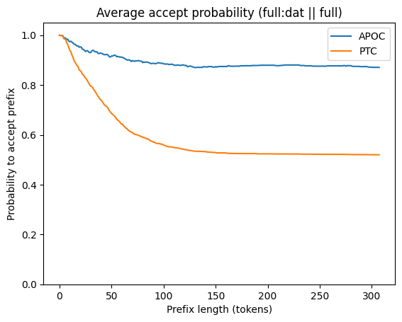
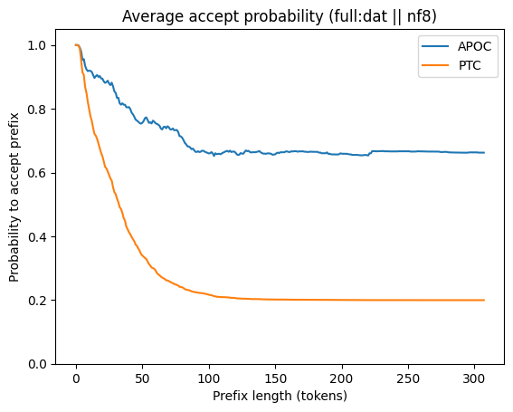
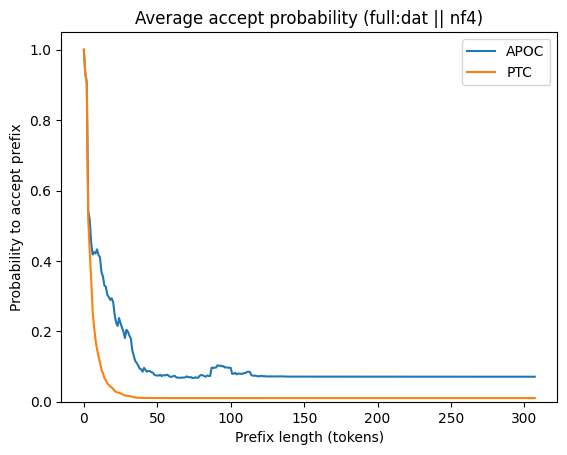

# APOC will substantially outperform PTC on nf8 quant (preliminary experiment)

When having quantized a model, we’d like to understand the differences introduced compared to the full-precision model. One approach is to generate paired responses, for which I’ve previously discussed three methods: same-seed (a specific case of Common Random Numbers (CRN)), Per-Token Coupling (PTC), and All-Prefix-Optimal Coupling (APOC).

To compare the effectiveness of the three methods for generating similar responses, one natural plot is the Longest Common Prefix (LCP) survival function (SF). This chart shows, for each possible prefix length `L >= 0`, the probability that the LCP of the two responses has length at least L.

Theoretically, it can be shown that APOC’s LCP SF strictly dominates PTC’s, and PTC’s LCP SF strictly dominates that of any CRN method (which, in particular, shows that it strictly dominates independent generation too). “Strictly dominates” here means: the upper curve is greater-than-or-equal-to the lower curve at every point; and there exist models such that the upper curve has at least point where it is strictly greater than the lower curve. In short:

```
CRN < PTC < APOC
```

(An important detail of the LCP SF: when the two responses are equal, I treat that as an infinite LCP. As a result, the asymptotic value of the APOC LCP SF is the maximum possible probability that the responses are equal in any coupling. That is equal to one minus the total variation distance (TVD).)

Though the theoretical ordering favors APOC, is the practical gap enough to justify the inconvenience compared to CRN? Theoretical arguments suggest that for sufficiently similar models, APOC outperforms PTC by arbitrarily large amounts, but it’s not clear whether real models ever are “sufficiently similar” in this sense.

To perform an experiment to see how much APOC actually outperforms PTC in practice, it turns out that we don’t need to implement either method, since the LCP SF curve can be estimated using generated responses with logprobs from both models. (I don’t describe the estimation technique here.)

This post reports the results of my first preliminary attempt at estimating LCP SFs of APOC and PTC.

## Methods

For this preliminary experiment, I used huggingface transformers, a tiny model (`Qwen/Qwen1.5-0.5B-Chat`), only one prompt, and 32 responses for that prompt.

I compare the full-precision model’s generation logits (`full:dat`) to three models whose logits are computed afterwards by forward pass:

- `full`: the full-precision model
- `nf8`: the `load_in_8bit` bitsandbytes quant
- `nf4`: the `load_in_4bit` bitsandbytes quant

System prompt:

```
You are a helpful assistant.
```

User prompt:

```
What color is the sky?
```

## Results

Response statistics:

```
Average response length = 89.2
Min response length = 10
Max response length = 307
```

These charts show the LCP SFs for each of APOC and PTC:

[](https://masharpe.wordpress.com/wp-content/uploads/2024/06/lcp_sf_full_full.png)
[](https://masharpe.wordpress.com/wp-content/uploads/2024/06/lcp_sf_full_nf8.png)
[](https://masharpe.wordpress.com/wp-content/uploads/2024/06/lcp_sf_full_nf4.png)

Here are the asymptotic values:

```
(full:dat || full) accept probabilities:  PTC 52.0% ; APOC 87.1%
(full:dat || nf8) accept probabilities:  PTC 20.0% ; APOC 66.2%
(full:dat || nf4) accept probabilities:  PTC 1.0% ; APOC 7.1%
```

In particular, the whole-response TVD for nf8 is 33.8%.

## Discussion

Observations:

- **The estimated APOC LCP SF curve is non-monotone.** SFs should be monotone, and the exact curve would be. The non-monotonicity is an artifact of the estimation.
- **`full:dat` and `full` differ significantly.** I believe this is due to floating-point error, though I have not carefully confirmed it. Unfortunately, bfloat16’s 7-bit fraction means that adjacent values differ by as much as ~0.8%, and that amount of error in logits accumulates to a significant error in whole-response probability. The inference engine seems not to be built to give precisely equal results from a single parallelized forward pass as from the incremental forward passes during generation.
- **APOC greatly outperforms PTC on `nf8`.** This shows that `nf8` is in a sweet spot where it’s not too close to `full:dat` (since the LCP SFs of both PTC and APOC are asymptotically 100% if the models are equal) but also not too far (in which case APOC loses its theoretical advantage over PTC, and additionally both LCP SFs fall rapidly to 0%).
- **APOC is still useful for `nf4`.** Though `nf4` is different enough from `full:dat` that neither APOC or PTC perform well, APOC holds on considerably longer.
