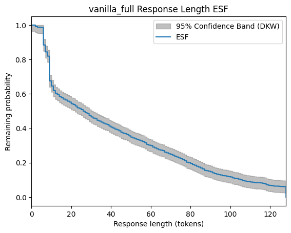
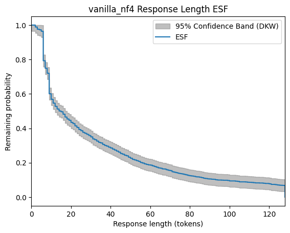
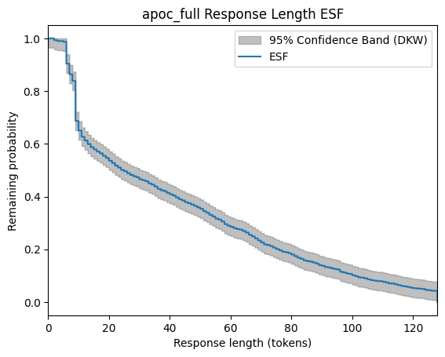
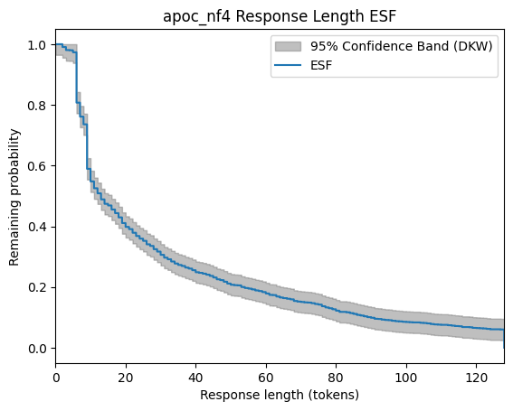
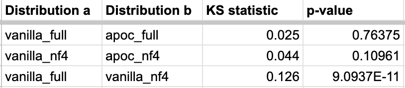
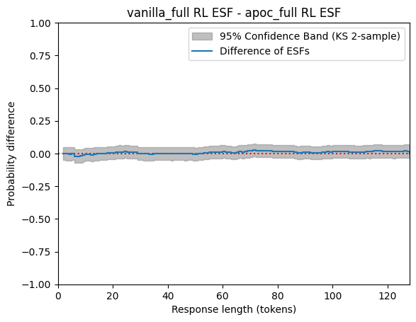
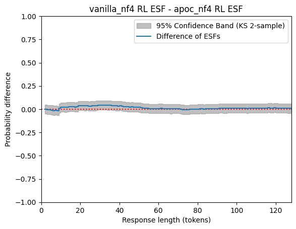
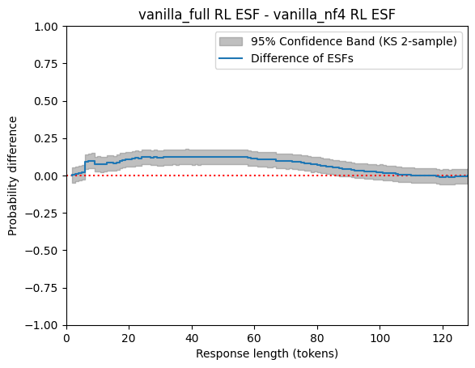

# APOC first implementation and preliminary testing

I recently programmed a first implementation of the APOC unconditional sampling algorithm. As input, it accepts two (model, prompt) pairs X and Y, and it returns a random sample from the APOC joint distribution.

To have confidence in the implementation’s correctness, testing is necessary, but it presents a special difficulty. Since the code implements a sampling algorithm, the output is random. Some sampling algorithms, such as `torch.multinomial`, can be tested using a goodness-of-fit test, such as chi-square. Here, though, the number of possible responses is typically so large that it makes chi-square unusable.

The two properties that need to be tested:

- Coupling validity: Each of the two marginal distributions must be correct.
- All-prefix optimality: The coupling must satisfy the all-prefix optimality property.

Coupling validity is the more important of the two and also the harder to test. Without loss of generality, we must check that these two sampling procedures yield the same distribution:

- Sample a response pair (X=a,Y=b) from APOC(X,Y), then return X=a.
- Sample a response X=a directly.

The most powerful way to distinguish two distributions is to [train a classifier](https://hamel.dev/blog/posts/drift/). Theoretically, if the two distributions are different, a classifier exists to distinguish them (see appendix).

However, it is not necessarily easy to train a classifier, and an insufficiently powerful classifier might fail to distinguish distinct distributions. It turns the distinguishing-distributions problem into a machine learning problem, which is great if you’re doing machine learning already, but in this project I am not, so I decided that this would be too much of a detour.

To simplify my need so that I don’t need the full power of machine learning, I observed that the testing is just a sanity check of my implementation. If the implementation is wrong, it’s likely that the marginal distributions are dramatically wrong, so any simple check should suffice.

There is a caveat however to my claim that an incorrect implementation would lead to dramatically wrong marginal distributions. Since floating-point error affects ordinary sampling and APOC sampling differently, we shouldn’t expect the response distributions to be *exactly* the same, even for an ideal implementation. This leads me to be more interested in putting a confidence interval on how much the distributions differ to ensure that the difference is small, even if it is statistically significant.

## Methods

The simple metric that I chose is the response length distribution. By taking the length of each response drawn from a distribution, we can obtain an empirical survival function (ESF). We can then compare the two ESFs using a [2-sample Kolmogorov-Smirnov test](https://en.wikipedia.org/wiki/Kolmogorov%E2%80%93Smirnov_test#Two-sample_Kolmogorov%E2%80%93Smirnov_test). This also gives a confidence band for the difference of the ESFs.

For the two distributions to pass to APOC, I used the model `Qwen/Qwen2-0.5B-Instruct` in both full-precision and bitsandbytes nf4-quantized forms. (The purpose of choosing nf4 instead of nf8 is that nf8 is not sufficiently different from full-precision to serve as a positive control.) I chose a single prompt that gives good response diversity with this model: “What color is the sky?”. Sampling is temperature 1. Maximum response length is capped at 128. Response length includes the EOS token.

I generate n=1500 responses in each of three ways:

- Vanilla sampling with the full model.
- Vanilla sampling with the nf4 model.
- APOC sampling of the full model and the nf4 model.

I then do three pairwise comparisons using the response length ESFs. Two test APOC, and the other one is a positive control.

- vanilla_full vs apoc_full. Expect equal.
- vanilla_nf4 vs apoc_nf4. Expect equal.
- vanilla_full vs vanilla_nf4. Positive control: expect not equal.

## Results

The four response length ESFs, with confidence bands computed using the Dvoretzky-Kiefer-Wolfowitz inequality.

[](https://masharpe.wordpress.com/wp-content/uploads/2024/07/esf_vanilla_full.png)
[](https://masharpe.wordpress.com/wp-content/uploads/2024/07/esf_vanilla_nf4.png)
[](https://masharpe.wordpress.com/wp-content/uploads/2024/07/esf_apoc_full.png)
[](https://masharpe.wordpress.com/wp-content/uploads/2024/07/esf_apoc_nf4.png)

The three pairwise differences of response length ESFs. The statistics are:

[](https://masharpe.wordpress.com/wp-content/uploads/2024/07/table.png)

[](https://masharpe.wordpress.com/wp-content/uploads/2024/07/esf_diff_vanilla_full_apoc_full.png)
[](https://masharpe.wordpress.com/wp-content/uploads/2024/07/esf_diff_vanilla_nf4_apoc_nf4.png)
[](https://masharpe.wordpress.com/wp-content/uploads/2024/07/esf_diff_vanilla_full_vanilla_nf4.png)

The positive control shows overwhelming statistical significance, while the others don’t reach any level of statistical significance. The confidence bands also appear tight enough to rule out any major difference between the distributions. Note that the upper bulge of the positive control indicates that the full model is returning longer responses than the nf4 model.

## Conclusions

This preliminary test suggests that the APOC unconditional sampling implementation yields a valid coupling.

## Appendix: Optimal classification of two distributions

Assume the class probabilities are equal. Theoretically, given the total variation distance (TVD), the optimal classifier has accuracy `(1/2)(1 + TVD)`. Here’s a short proof idea via optimal coupling.

Obviously, given an outcome x, the classifier should guess whichever distribution assigns x higher likelihood. Now consider a coupling of X and Y that is optimal in the sense of maximizing the probability of equality. It’s well-known that this optimal equality probability is 1-TVD(X,Y).

For a (x,y) sampled from the optimal coupling,

- With probability TVD(X,Y), x and y are not equal. In this case, because the coupling is optimal, x is higher likelihood in distribution X, and y is higher likelihood in distribution Y. Thus the classifier classifies both x and y correctly.
- With probability 1-TVD(X,Y), x and y are equal. Since the inputs to the classifier are equal, so are the predictions, so the classifier classifies one correctly and one incorrectly.

This gives accuracy

```
TVD(X,Y) * 1 + (1 - TVD(X,Y)) * 0.5
    = (1/2)(1 + TVD(X,Y))
```

For an alternative approach to the proof, see [Tao et al. 2024](https://arxiv.org/abs/2405.15337).
