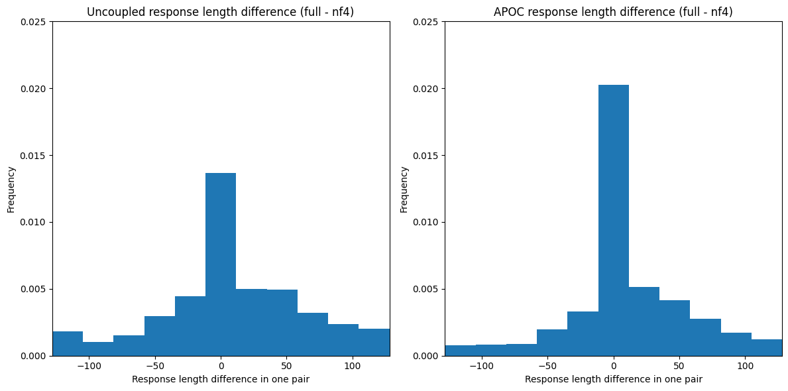
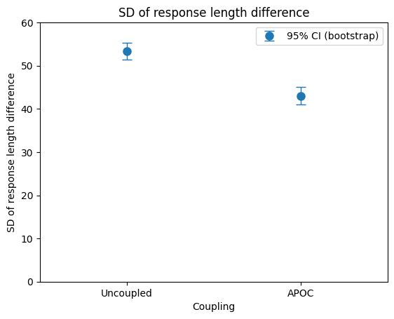

# Preliminary experiment: APOC for variance reduction

Imagine you have two similar LLM response distributions, such as from a full-precision model and a quantization, and there is some function f of the response for which you want to know whether the average value differs and by how much. (A practical example of such an f is if a response can receive a like, neutral, or dislike rating from a human evaluator, giving a {+1, 0, -1}-valued f.)

The simplest approach to estimating the expected value of the difference of f is to sample independently from each response distribution and take the difference of the expected values of f. But we might be able to reduce the variance of the estimate by coupling the responses, which would give us a more accurate estimate from the same amount of data. APOC is a natural choice as a coupling method, because of its all-prefix optimality property.

So we’d like to compare the estimate variance achieved by uncoupled sampling and APOC sampling, for an example f.

## Note on bootstrapping

When analyzing the results, it will be helpful to have confidence intervals for measures of variability, in particular standard deviation (though variance would also be acceptable). It turns out that such CIs are not easy to obtain.

There seem to be two methods commonly mentioned for obtaining CIs for variance:

- F-test. Sources seem to agree that the important thing to know about F-test is that you should never use it. F-test assumes normality and is not robust to violations of that assumption.
- Bootstrapping. This seems to be the preferred method and is easy to do using `scipy.stats.bootstrap`, but it’s unclear under what conditions it works.

To avoid getting trapped in a rabbit hole of statistics, I chose to use bootstrapping without worrying about its validity.

Finally, to simply show that APOC significantly reduces variance compared to uncoupled sampling, we can use a permutation test (via `scipy.stats.permutation_test`), the validity of which is much easier to understand than in the case of bootstrap.

## Methods

Let `f(a)` be the length of the response a. The reason for this choice is that it’s straightforward and easy to compute.

We reuse the data from [APOC preliminary testing](2024-07-02-apoc-first-implementation-and-preliminary-testing.md):

- Model: `Qwen/Qwen2-0.5B-Instruct`
- Quantizations: full-precison and nf4
- Prompt: “What color is the sky?”
- Maximum response length: 128 tokens
- n=1500 responses from each of uncoupled full-precision, uncoupled nf4, and APOC with full-precision and nf4

We pair the uncoupled responses arbitrarily, so we have n uncoupled pairs and n APOC pairs. Within each pair, we compute the length of each response, then compute the difference as `full response length - nf4 response length`.

## Results

The first indication of APOC’s impact is in the number of equal responses within pairs:

- Uncoupled: 28/1500 equal response pairs (1.9%)
- APOC: 454/1500 equal response pairs (30.3%)

Plotting the response length differences, the APOC histogram appears slightly more concentrated:

This is reflected in confidence intervals for the mean response length difference (via normal approximation):

- Uncoupled: 8.95, 95% CI [6.25, 11.66]
- APOC: 9.70, 95% CI [7.52, 11.88]

The confidence interval is slightly tighter for APOC.

However, could the tighter CI just be due to luck? We need also confidence intervals for some measure of data variability. For this, we use bootstrapped confidence intervals for the standard deviations of response length difference (10,000 resamples, BCa interval):

- Uncoupled: 53.39, 95% CI [51.46, 55.37]
- APOC: 43.01, 95% CI [41.14, 45.02]

In a plot, it’s easy to see that the confidence intervals are well-separated:

Finally, the ratio of variances can give an indication of how much APOC improves the data efficiency. Again, the confidence interval is bootstrapped (10,000 resamples, BCa interval):

- Ratio of uncoupled variance to APOC variance: 1.541, 95% CI [1.369, 1.727]

Then we use a permutation test (10,000 resamples) to calculate a p-value for the variance ratio:

- 1.541 (p < 0.0002)

## Discussion

The results show that APOC does indeed reduce variance of response length difference compared to uncoupled sampling, which allows us to produce a more accurate estimate of mean response length difference.

However, the amount of variance reduction is not as much as I hoped before doing this experiment. Some speculation as to why:

- nf4 quantization is more different from full-precision than a milder quantization, such as nf8. That reduces the amount of similarity that is possible to achieve.
- APOC induces the strongest similarity at the beginnings of responses, but length is determined more by the decisions near the end of responses, in particular whether to emit EOS. So response length in particular might be an unfavorable function for APOC.
- APOC induces relatively more similarity in short responses than in long responses, since the length of the longest common prefix likely doesn’t depend much on response length. But long responses are also those that contribute most to variability of response length difference.
