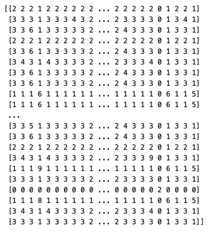

# Estimating mean uncoupled LCP using cross-product averaging

As a baseline for coupling methods for LLM responses, such as APOC, we’d like to estimate the mean length of the longest common prefix between two uncoupled responses. It turns out there is an obvious but interesting trick for reducing the variance of this estimate.

Let X and Y be the (uncoupled) responses from the two LLMs, and let f(X,Y) be the length of their LCP. The quantity we want to estimate is

```
E[ f(X,Y) ]
```

The easiest way to do this is to treat f(X,Y) itself as a random variable. With that mindset, we generate n responses from each LLM and use the estimator

```
(1/n) sum_i f(X_i, Y_i)
```

But since X and Y are uncoupled, the pairing (X_i, Y_i) is arbitrary, so there’s an obvious improvement available: average over the cross-product.

```
(1/n^2) sum_{i,j} f(X_i, Y_j)
```

Then we wonder how much better this cross-product estimator is.

## Variance of the cross-product estimator

For convenience, let `A_{i,j} = f(X_i, Y_j)`.

The variance of the paired estimator:

```
Var[(1/n) sum_i A_{i,i}] = (1/n) Var[ A_{1,1} ]
```

To calculate the variance of the cross-product estimator, note that the covariance between cells is zero unless they share a row or column. We thus get

```
Var[(1/n^2) sum_{i,j} A_{i,j}]
    = (1/n^2) (var + (n-1) cov_col + (n-1) cov_row)
```

where

```
var = Var[A_{1,1}]
cov_col = Cov[A_{1,1}, A_{2,1}]
cov_row = Cov[A_{1,1}, A_{1,2}]
```

The ratio of the cross-product estimator’s variance to the paired estimator’s variance can be written using correlation coefficients:

```
(1/n)(1 + (n-1) corr_col + (n-1) corr_row)
```

where

```
corr_col = cov_col / var
corr_row = cov_row / var
```

Note that, as we’d expect, the dependence between cells never improves the estimator’s variance. Indeed, using the law of total covariance, we can show:

```
cov_col = Cov[f(X_1, Y_1), f(X_2, Y_1)] = Var_{Y_1}[ E_{X_1}[ f(X_1, Y_1) ] ] >= 0
```

and likewise `cov_row >= 0`. So the variance ratio is lower-bounded by `1/n`.

It’s helpful to study two illustrative examples, which show the extremes of the variance ratio.

### Example: XOR

Let X and Y be Bernoulli(0.5) and f be XOR. In that case, cov_col and cov_row are both zero, so the variance ratio is `1/n`, the best possible.

### Example: addition

Let X and Y be N(0,1) and let f be sum. In that case, var is 2 and cov_col and cov_row are both 1, so the variance ratio is 1, i.e. the variance isn’t improved at all.

## Methods

We’d like to know how much improvement we get by using the cross-product estimator for our LCP problem, and there’s no good way to do this aside from experiment.

We’ll calculate the ratio of the bootstrapped standard errors, as well as use the empirical variance and covariances to see whether that ratio is consistent with the theory above.

Data details:

- Model: `Qwen/Qwen2-0.5B-Instruct`
- Quantizations: full-precison and nf8
- Prompt: “What color is the sky?”
- Maximum response length: 128 tokens
- n=200 responses from each of uncoupled full-precision and uncoupled nf8

## Results

The bootstrapped (10,000 resamples) standard errors and their ratio:

```
Paired estimator SE = 0.0933
Cross-product estimator SE = 0.0590
Ratio of SEs = 0.632
```

The empirical variance and covariances. (Note that cov_col varies the full response and cov_row varies the nf8 response.)

```
var = 1.791
cov_col = 0.393
cov_row = 0.272
```

Plugging this into the formula above, we get a predicted SE ratio of 0.612, close to what we got from bootstrapping.

## Discussion

The achieved SE reduction of 0.632 is as much reduction as we’d get by increasing sample size by about 2.5x, so it’s helpful. That said, it’s much worse than best possible reduction, `sqrt(1/n) = 0.071`.

To understand why the ratio came out higher than ideal, it’s helpful to look at the matrix of LCPs.

[](https://masharpe.wordpress.com/wp-content/uploads/2024/07/lcp_matrix.png)

The LCP matrix.  
Each row is one full-precision response and each column one nf8 response.

Observe that there appears to be a lot of correlation within rows and columns. For example, there’s a row that’s nearly all zeros, and multiple rows that are mostly 1.
