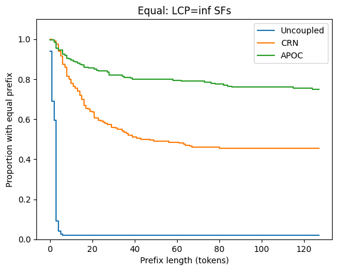
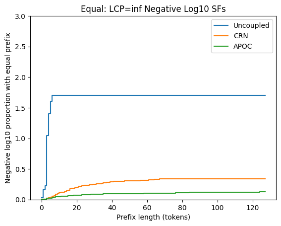
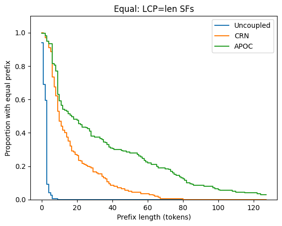
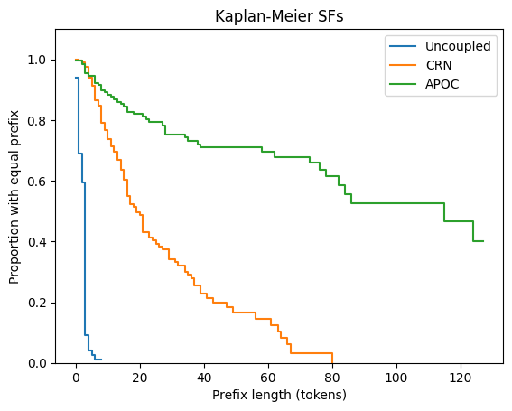
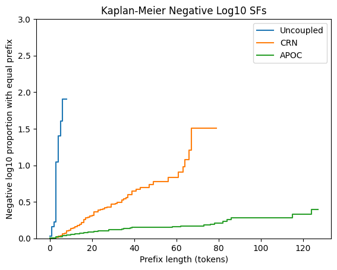

# Kaplan-Meier for LCP SFs

In the testing and evaluation of APOC against baselines, a key visualization is the [longest-common-prefix survival function](2024-06-04-apoc-will-substantially-outperform-ptc-on-nf8-quant-preliminary-experiment.md). Though I’ve discussed it before on this blog, there is a tricky issue that I neglected and was leading to unsatisfactory visualizations. I recently noticed an unexpected solution using the Kaplan-Meier survival function estimator.

The particular issue with LCP SFs is how to handle response pairs that terminate with equality (because they sampled EOS together). I’ll discuss my initial ideas before showing how KM yields a superior solution.

## Equal-response LCP treated as infinite

The first idea is to imagine that, after a response samples EOS once, it samples EOS forever. In that case, response pairs that sample EOS together would forever be equal, making the LCP infinite. That idea produces the following plot:

The eye immediately notices the nonzero right asymptote. It has a useful interpretation: it is the probability that a response pair is equal. For APOC, that gives one minus the whole-response TVD.

Despite that meaningful interpretation, having a nonzero right asymptote causes problems.

First, it overstates the effectiveness of the weak baseline CRN. CRN is not creating a non-negligible number of pairs with LCPs longer than 80 tokens, but you wouldn’t know it from this chart, because the right asymptote is buoyed by short equal pairs.

Second, look at what it does to the negative log survival plot:

The nonzero right asymptote causes the curves to bend to the right. For negative log to be effective, the asymptote needs to be zero.

The more severe of these two problems is overrating the weak baseline, but it would also be nice to have a meaningful negative log survival plot.

## Equal-response LCP treated as the response length

To achieve a zero right asymptote, a natural idea is, when the responses are equal, define their LCP to be equal to their length. As long as every response eventually terminates, that ensures a zero right asymptote. That idea produces the following plot:

Now the right asymptote is zero, but there’s a new issue subtly lurking. This plot underrates all coupling methods, with the underrating being greater the more effective they are. Even if a model is coupled to itself so that every response pair is equal, the curve becomes the response length SF, and still rapidly drops to zero as responses terminate.

It seems more fair if, in the special case when every response pair is equal, the curve never decreases.

## Kaplan-Meier

To recap, we want to define the LCP SF so that:

- When the models aren’t equal, the right asymptote is (typically) zero.
- When the models are equal and optimally coupled, the curve never decreases.

The [Kaplan-Meier survival function estimator](https://en.wikipedia.org/wiki/Kaplan%E2%80%93Meier_estimator) offers a solution. It uses the concept of “right-censoring”. A living subject is right-censored if further information becomes unavailable beyond a certain time. They presumably die sometime later, but we don’t know when.

To apply KM to the LCP SF, for response pairs that terminate with equality, we model them as being right-censored. It’s as if the model continued on with writing future responses (perhaps to user follow-ups) that we don’t have access to. The idea produces this plot:

As we wanted, the right asymptote is zero (although APOC is so strong that we’d need longer responses for its curve to approach zero). KM also satisfies our second criterion, since, by definition, its curve only decreases when a death event occurs, and optimally coupled equal models would never have a death event.

Happily, this plot is the best so far at showing the strength of APOC against the weak baseline CRN. While in general it’s suspect to cherry-pick the plots that are kindest to my favored algorithm, in this case, creating a clear visual separation between coupling methods is the point. (A non-cherry-picked plot likely wouldn’t use LCP as its metric!)

Finally, we get a more pleasing negative log survival plot:

## Discussion

There’s a subtle difference here from standard uses of KM. Usually, there is some survival function of natural interest, and KM is a way to estimate it. In the case of the LCP SF, though, it’s not obvious what’s the best way to define it, and each of the plots reflects a different definition. The KM formula becomes the definition of the SF itself, not just an estimator.

The choice of how to define the LCP SF also impacts the calculation of the mean LCP. The mean LCP is simply the definite integral of the SF. Thus, changing the SF definition changes the mean too.

In the future, I’ll definitely reach for KM whenever visualizing failure times within trials of varying lengths.
