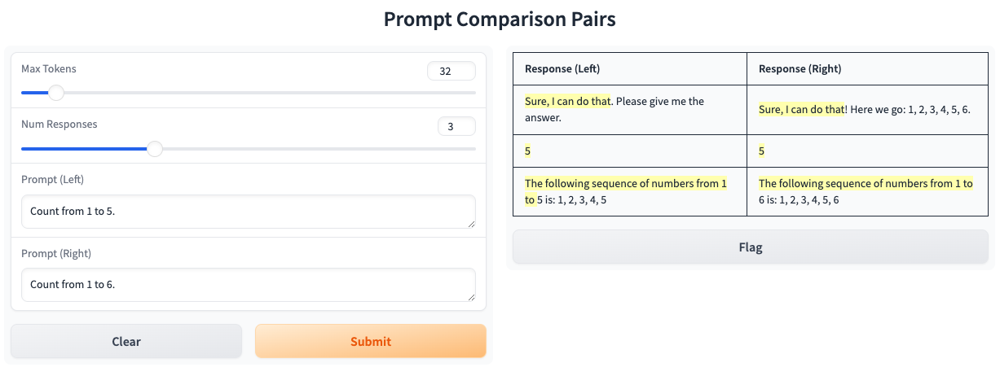
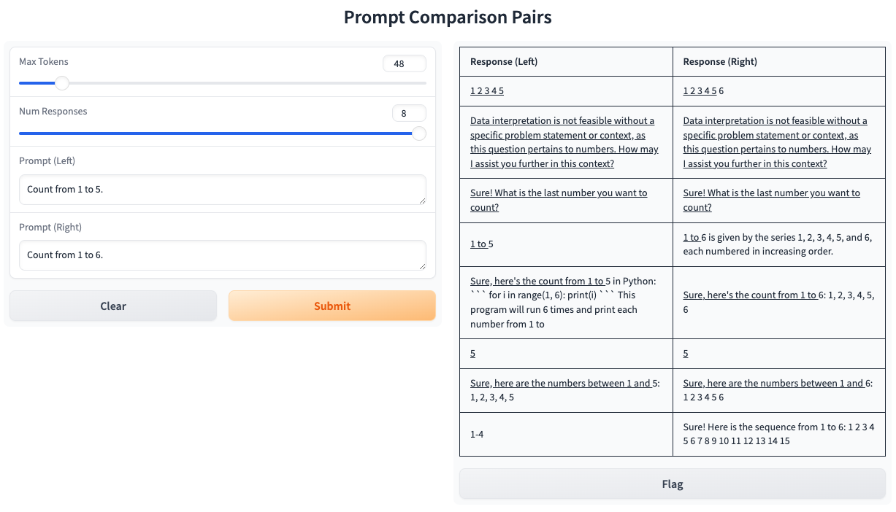

# Prototyping an APOC demo

Towards creating a compelling demo of APOC, here is a prototype of a demo for using APOC for prompt engineering.

(I haven’t settled on a highlight style yet. The color highlight is more of a search or diff style highlight, while the underline has an easier-to-see boundary.)

Details:

- Model: `Qwen/Qwen2-0.5B-Instruct` (full precision). Its small size accounts for the quirky output.
- Inference backend: Hugging Face transformers.
- Response pair distribution: APOC unconditional.
- Sampling configuration: neutral (i.e. temperature=1).
- UI framework: Gradio.

## Motivation and explanation

When prompt engineering, when you tweak the prompt, it can be hard to tell whether the output varies because of your prompt change or because of sampling randomness. APOC reduces the impact of sampling randomness, in a certain sense optimally. (Note: the most common option in use today for reducing sampling randomness is to use a fixed seed.)

In the example screenshots, often the model returns a quirky response, but APOC helps increase the chance that both prompts return the *same* quirky response. Note though that this only works before the responses split into non-equal suffixes.

## Limitations and future work

- There’s no comparison against a baseline. Fixed-seed is the obvious baseline to use. Ideally, there’d be three columns, one for the reference response, one for the fixed-seed response, and one for the APOC response. To do this requires implementing APOC conditional sampling.
- The suffixes are uncoupled: for example, in one of the example response pairs, the left response emits Python code in its suffix and the right response doesn’t. If the suffixes were coupled too, it might be possible to have them both emit code in the suffix. This is an interesting problem but creates additional difficulties.
- The model is useless. Though Qwen2-0.5B is great for testing, it has no practical use, so it’s awkward to try a prompt engineering workflow with this demo.
- The generation is slow. It’s currently running on CPU and unbatched. Moving it to GPU is not too hard, but batching APOC is non-trivial.
